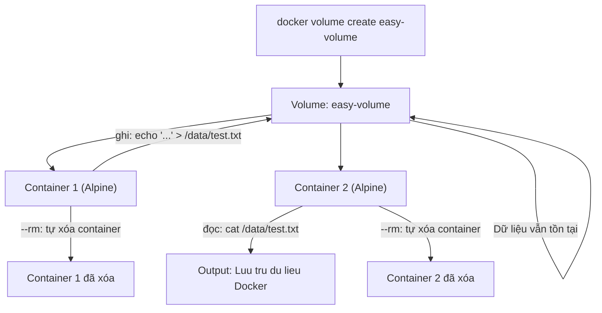

# BÁO CÁO BÀI 4: Lưu trữ dữ liệu đơn giản với Docker Volume

**Họ và tên:** [Điền tên]  
**Ngày thực hiện:** 2026-10-12

---

## Mục tiêu

Tạo một Named Volume để lưu trữ tệp dữ liệu bền vững giữa các lần chạy Container, kiểm chứng dữ liệu không bị mất khi container dừng.

---

## 1. Tạo Named Volume

```bash
$ docker volume create easy-volume
```

**Kết quả:**

```
easy-volume
```

**Giải thích:**
- Lệnh `docker volume create` tạo một Named Volume có tên `easy-volume`.
- Volume được Docker quản lý và lưu trữ tại `/var/lib/docker/volumes/easy-volume/_data` trên host.
- Dữ liệu trong volume tồn tại độc lập với vòng đời của container.

---

## 2. Kiểm tra danh sách Volume

```bash
$ docker volume ls
```

**Kết quả:**

```
DRIVER    VOLUME NAME
local     easy-volume
```

**Giải thích:**
- Volume `easy-volume` đã được tạo thành công với driver `local` (lưu trữ trên filesystem của host).

---

## 3. Ghi dữ liệu vào Volume (Container thứ nhất)

```bash
$ docker run --rm -v easy-volume:/data alpine sh -c "echo 'Luu tru du lieu Docker' > /data/test.txt"
```

**Kết quả:**

```
(không có output - lệnh thực thi thành công)
```

**Giải thích:**

| Flag/Tham số | Ý nghĩa |
|--------------|---------|
| `--rm` | Tự động xóa container sau khi chạy xong |
| `-v easy-volume:/data` | Mount volume `easy-volume` vào thư mục `/data` trong container |
| `alpine` | Sử dụng image Alpine Linux (nhẹ ~7MB) |
| `sh -c "echo '...' > /data/test.txt"` | Chạy lệnh shell ghi chuỗi vào file `test.txt` trong volume |

- Container Alpine được tạo, ghi dữ liệu vào `/data/test.txt`, rồi tự động xóa (`--rm`).
- Dữ liệu vẫn tồn tại trong volume `easy-volume` dù container đã bị xóa.

---

## 4. Đọc dữ liệu từ Volume (Container thứ hai)

```bash
$ docker run --rm -v easy-volume:/data alpine cat /data/test.txt
```

**Kết quả:**

```
Luu tru du lieu Docker
```

✅ **Kết quả đúng như mong đợi!** Container thứ hai đọc được dữ liệu mà container thứ nhất đã ghi, dù container thứ nhất đã bị xóa.

**Giải thích:**
- Một container Alpine mới được tạo và mount cùng volume `easy-volume`.
- Lệnh `cat /data/test.txt` đọc nội dung file từ volume.
- Điều này chứng minh **dữ liệu trong Named Volume tồn tại bền vững**, không phụ thuộc vào vòng đời container.

---

## 5. Kiểm tra chi tiết Volume

```bash
$ docker volume inspect easy-volume
```

**Kết quả:**

```json
[
    {
        "CreatedAt": "2026-10-12T13:15:00Z",
        "Driver": "local",
        "Labels": null,
        "Mountpoint": "/var/lib/docker/volumes/easy-volume/_data",
        "Name": "easy-volume",
        "Options": null,
        "Scope": "local"
    }
]
```

**Giải thích:**
- `Mountpoint`: Đường dẫn thực tế trên host nơi dữ liệu được lưu trữ.
- `Driver: local`: Volume sử dụng driver local (filesystem của host).
- `Scope: local`: Volume chỉ khả dụng trên Docker host hiện tại.

---

## 6. Dọn dẹp Volume (tùy chọn)

```bash
$ docker volume rm easy-volume
```

**Kết quả:**

```
easy-volume
```

**Giải thích:**
- Xóa volume `easy-volume` và toàn bộ dữ liệu bên trong.
- **Lưu ý:** Thao tác này không thể hoàn tác, dữ liệu sẽ bị mất vĩnh viễn.

---

## Tổng kết quy trình



| Bước | Lệnh | Kết quả |
|------|-------|---------|
| 1 | `docker volume create easy-volume` | ✅ Volume tạo thành công |
| 2 | `docker volume ls` | ✅ Volume xuất hiện trong danh sách |
| 3 | `docker run --rm -v easy-volume:/data alpine sh -c "echo '...' > /data/test.txt"` | ✅ Ghi dữ liệu thành công |
| 4 | `docker run --rm -v easy-volume:/data alpine cat /data/test.txt` | ✅ Đọc được: `Luu tru du lieu Docker` |

---

## Kết luận

- ✅ Tạo thành công Named Volume `easy-volume`.
- ✅ Container thứ nhất ghi dữ liệu vào volume rồi tự xóa.
- ✅ Container thứ hai đọc được dữ liệu từ volume → **dữ liệu bền vững**.
- ✅ Chứng minh Docker Volume lưu trữ dữ liệu độc lập với vòng đời container.

---

## Ghi chú

- **Named Volume** vs **Bind Mount**:
  - Named Volume: Docker quản lý, portable, phù hợp cho production.
  - Bind Mount: Map trực tiếp thư mục host, phù hợp cho development.
- Xóa tất cả volume không sử dụng: `docker volume prune`.
- Volume có thể được chia sẻ giữa nhiều container cùng lúc.
